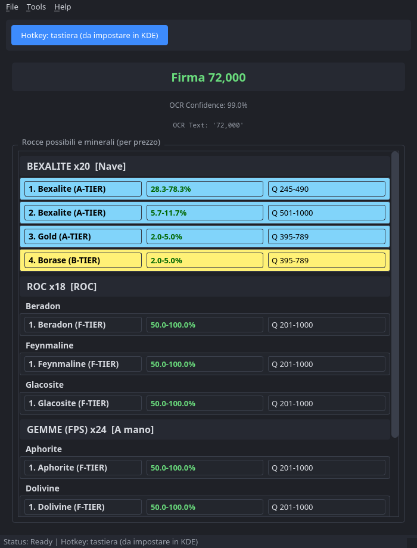
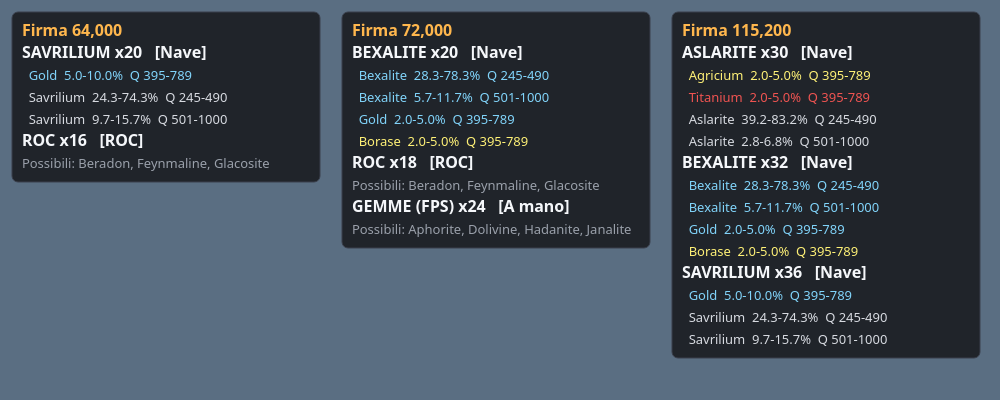

<div align="center">

# SC Radar Signal

**Che roccia è? Te lo dice la firma radar.** Premi un tasto (o un pulsante del joystick) mentre
in Star Citizen hai una firma radar sullo schermo: SC Radar Signal legge il numero, ti dice
che roccia è, quante sono e quali minerali contiene, ordinati per valore.

[](https://github.com/rastlien78/SC-Radar-Signal/releases/latest)
[](https://github.com/rastlien78/SC-Radar-Signal/releases)


[**⬇ Scarica**](#-download) · [Funzionalità](#-funzionalità) · [Installazione](#-installazione) · [Primo avvio](#-primo-avvio) · [Domande frequenti](#-domande-frequenti) · [Novità](CHANGELOG.md)

</div>

<p align="center">
  
  &nbsp;
  
</p>

---

## ⬇ Download

| Sistema | File | |
|---|---|---|
| **Windows** 10/11 (64 bit) | `SC-Radar-Signal-Windows-x64.zip` | [**Scarica**](https://github.com/rastlien78/SC-Radar-Signal/releases/latest/download/SC-Radar-Signal-Windows-x64.zip) |
| **Linux** x86_64 | `SC-Radar-Signal-Linux-x86_64.tar.gz` | [**Scarica**](https://github.com/rastlien78/SC-Radar-Signal/releases/latest/download/SC-Radar-Signal-Linux-x86_64.tar.gz) |

Tutte le versioni, con le note di rilascio, sono nella pagina
[**Releases**](https://github.com/rastlien78/SC-Radar-Signal/releases).
Ogni release include `SHA256SUMS.txt` per verificare l'integrità dei file.

> **Nessuna installazione necessaria**: estrai l'archivio in una cartella tua e avvia il
> programma. I dati di gioco vengono aggiornati automaticamente a ogni avvio.

---

## ✨ Funzionalità

### 📡 Dalla firma alla roccia
- Premi il **tasto** o il **pulsante del joystick** che hai scelto: l'app cattura la zona dello
  schermo con la firma radar, la legge (OCR) e la confronta con i dati di gioco.
- Riconosce anche **più rocce insieme** (es. `7,170` = 2 rocce di Gold) e mostra **tutti i
  minerali** con percentuale, qualità e colore per fascia di valore.
- **Riquadro sopra il gioco**: firma letta, rocce possibili e minerali compaiono direttamente
  sullo schermo, senza uscire dal gioco. Si sposta dove vuoi e si può spegnere.
- La **firma letta** è sempre in cima: vedi subito se la lettura è giusta. Se il numero non si
  legge, il riquadro scrive «Firma non letta» invece di mostrare un risultato vecchio.

### ⛏ Nave, ROC o a mano
- Alcune firme valgono per più tipi di estrazione (es. `64,000` = 20 rocce di Savrilium da
  nave **oppure** 16 depositi da ROC). In modalità **Automatico** l'app le mostra tutte,
  nell'ordine Nave → ROC → A mano; scegliendo **Nave**, **ROC** o **A mano** considera solo
  quella.

### 📍 Dove trovare
- Per ogni minerale e gemma: **dove** si trova (Stanton, Pyro, Nyx), in quale roccia, con che
  percentuale e qualità.

### 🎮 Tastiera e joystick
- Combinazione di tasti globale (es. `Ctrl+F9`) oppure **qualsiasi pulsante di qualsiasi
  joystick**, compresi VIRPIL, WINWING e VKB.
- Se il joystick si scollega e si ricollega, l'app lo ritrova da sola.

### 💾 Comodità
- **Aggiornamento automatico dei dati di gioco** all'avvio (solo i file cambiati).
- **Avviso di nuova versione** all'avvio, con le novità e il link per scaricarla.
- Tema scuro, calibrazione della zona di lettura con un click.

---

## 🚀 Installazione

### Windows
1. Scarica `SC-Radar-Signal-Windows-x64.zip` ed estrailo in una **cartella tua**
   (es. `Documenti\SC-Radar-Signal\`), non in `C:\Program Files`.
2. Avvia `SC-Radar-Signal.exe`.
3. Se compare **«Windows ha protetto il PC»** (SmartScreen): clicca **Ulteriori informazioni →
   Esegui comunque**. L'avviso appare perché l'eseguibile non ha una firma digitale a pagamento.

### Linux
```bash
mkdir -p ~/Applicazioni && cd ~/Applicazioni
tar -xzf ~/Scaricati/SC-Radar-Signal-Linux-x86_64.tar.gz
./SC-Radar-Signal/SC-Radar-Signal
```

> **Distribuzioni supportate**: qualsiasi distribuzione x86_64 con glibc 2.35 o superiore
> (Ubuntu 22.04+, Linux Mint 21+, Debian 12+, Fedora, Arch/CachyOS, SteamOS).
>
> **Cattura dello schermo**: X11, **KDE Plasma** su Wayland e desktop wlroots (Sway, Hyprland)
> con `grim` installato. GNOME su Wayland non è supportato.

### Cosa c'è nella cartella
- `data/` — i dati di gioco, aggiornati a ogni avvio;
- `config/` — le tue impostazioni (`user_config.json`, creato al primo avvio);
- `logs/` — il registro dell'app, utile se qualcosa non va.

La cartella deve essere **scrivibile**. Se la sposti, sposta tutto insieme.

### Aggiornare
Estrai la nuova versione e copia dentro `config/` il file `config/user_config.json` di quella
vecchia: così mantieni calibrazione, tasti e preferenze. Quando esce una nuova versione, l'app
te lo segnala all'avvio.

---

## 🧭 Primo avvio

1. **Gioca in finestra senza bordi** (*Borderless*): il riquadro sopra il gioco e la cattura
   funzionano sul **monitor principale**.
2. **Calibra la zona della firma** — `Tools → Quick Adjust ROI`: con la firma radar visibile
   sullo schermo, **clicca sul numero** e la zona si aggancia da sola (puoi rifinirla
   trascinando i bordi). Tieni dentro **solo le cifre**, senza il simbolo accanto. **INVIO** per
   salvare. La zona predefinita va bene per gli schermi 16:9, ma conviene sempre verificarla.
3. **Scegli il comando** — pulsante **Hotkey** nella finestra principale:
   - **Tastiera…**: una combinazione (es. `Ctrl+F9`). Su Linux la combinazione va confermata
     nelle scorciatoie globali del desktop (es. KDE Plasma); se il desktop non le supporta,
     usa il joystick;
   - **Joystick…**: premi il pulsante che vuoi usare.
4. **Modalità di estrazione** — `Tools → Modalità estrazione`: *Automatico* se non vuoi
   pensarci, oppure *Nave*, *ROC* o *A mano* per risultati senza ambiguità.
5. **Posizione del riquadro** — `Tools → Sposta riquadro sopra il gioco…`: trascinalo dove non
   ti dà fastidio e premi **INVIO**. Si spegne da `Tools → Info roccia sopra il gioco`.

---

## ❓ Domande frequenti

<details>
<summary><b>La firma viene letta male o non viene letta</b></summary>

Ricalibra la zona (`Tools → Quick Adjust ROI`) stringendola sulle **sole cifre**. Con sfondi
molto chiari (neve, sole) il numero può non essere leggibile: in quel caso l'app scrive
«Firma non letta» invece di indovinare. Cambia angolazione e riprova.
</details>

<details>
<summary><b>Perché a volte mostra più rocce diverse?</b></summary>

Perché la firma radar è la somma delle rocce: lo stesso numero può corrispondere a rocce
diverse (es. `64,000` = 20 Savrilium oppure 16 depositi ROC). Scegli la modalità di
estrazione (`Tools → Modalità estrazione`) per vedere solo quella che ti interessa.
</details>

<details>
<summary><b>Il riquadro non compare sopra il gioco</b></summary>

Verifica che il gioco sia in modalità **finestra senza bordi** e sul monitor principale, e che
`Tools → Info roccia sopra il gioco` sia attivo. Il riquadro compare dopo la prima scansione.
</details>

<details>
<summary><b>Il joystick non risponde</b></summary>

Riassegna il pulsante da **Hotkey → Joystick…**. Se usi un VIRPIL e cambi profilo nel firmware
(«Joystick»/«Combined»), il dispositivo cambia identità e va riassegnato.
</details>

<details>
<summary><b>L'antivirus segnala il file: è pericoloso?</b></summary>

No. Gli eseguibili creati con PyInstaller a volte vengono segnalati per errore («falso
positivo»). Puoi verificare che il file sia quello originale confrontando il suo SHA-256 con
`SHA256SUMS.txt` della release.
</details>

<details>
<summary><b>I dati sono aggiornati all'ultima patch?</b></summary>

I dati provengono da [StarCitizenWiki/scunpacked-data](https://github.com/StarCitizenWiki/scunpacked-data),
estratti dai file di gioco a ogni patch. L'app controlla all'avvio e scarica solo ciò che è
cambiato. Con **Salta** (o senza connessione) parte coi dati già presenti.
</details>

<details>
<summary><b>Ho trovato un bug / ho un'idea</b></summary>

Apri una segnalazione nella sezione [**Issues**](https://github.com/rastlien78/SC-Radar-Signal/issues),
allegando se puoi il file `logs/app.log`.
</details>

---

## 📄 Crediti e licenze

- **Autore**: Rasty78. SC Radar Signal è gratuito; il codice sorgente non è pubblico.
- **Dati di gioco**: [StarCitizenWiki/scunpacked-data](https://github.com/StarCitizenWiki/scunpacked-data).
- **Componenti di terze parti**: l'interfaccia usa Qt for Python (PySide6), con licenza
  **LGPL v3**; l'OCR usa RapidOCR e i modelli PaddleOCR (Apache 2.0). Elenco completo in
  [THIRD_PARTY_NOTICES.md](THIRD_PARTY_NOTICES.md).

*SC Radar Signal è un progetto amatoriale della community, non affiliato né approvato da Cloud
Imperium Games. Star Citizen® è un marchio registrato di Cloud Imperium Rights LLC.*
